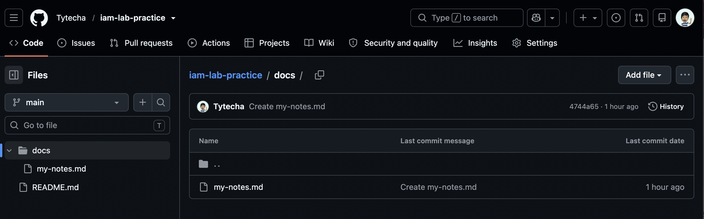

# Employee Access Management Lab with Microsoft Entra ID

## Project Overview

This practice project simulates managing an employee’s access from onboarding through offboarding using Microsoft Entra ID. It covers user creation, group membership, application access, and sign-in troubleshooting.

## Business Scenario

BrightPath Consulting is a fictional company with 50 employees. The company needed a consistent process to give new employees appropriate access, investigate sign-in problems, and remove access when employees leave.

## Tools Used

- Microsoft Entra ID

## What I Built

This fictional example includes the following sections of work:

### 1. Employee Onboarding
Created a test employee named Jordan Lee and added basic profile information, including department and job title.

### 2. Group-Based Access
Created a Sales security group and added Jordan to it to organize access by job responsibility.

### 3. Application Sign-In
Configured a test application for employee sign-in and documented how access was assigned.

### 4. Failed Login Investigation
Simulated an unsuccessful sign-in and reviewed the sign-in logs to identify the failure reason and document troubleshooting steps.

### 5. Employee Offboarding
Blocked the test employee’s sign-in, revoked sessions, and removed group memberships and application assignments.

### 6. Validation
Documented expected and actual results for onboarding, application access, login troubleshooting, and offboarding.

## Screenshots

## Security Lessons Learned

- Least privilege means giving employees only the access needed for their roles.
- Groups help make access assignments consistent and easier to review.
- Sign-in logs provide evidence for troubleshooting authentication issues.
- Offboarding should address sign-in, active sessions, and access assignments.
- Public portfolio screenshots should exclude passwords, tokens, and personal information.

## Future Improvements

- Practice configuring multifactor authentication for test users.
- Explore Conditional Access policies when the required licensing is available.
- Automate parts of onboarding and offboarding using Microsoft Graph PowerShell.
- Add more test employees to practice access changes when someone moves departments.
- Expand the documentation with actual test results, troubleshooting notes, and sanitized screenshots.
